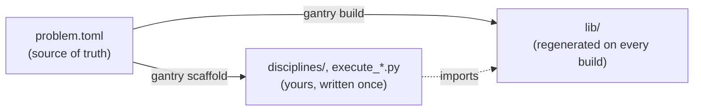

# gemseo-gantry

[](https://github.com/axwide/gantry/actions/workflows/ci.yml)
[](https://pypi.org/project/gemseo-gantry/)
[](https://pypi.org/project/gemseo-gantry/)
[](https://gemseo.readthedocs.io/)
[](https://github.com/axwide/gantry/blob/main/LICENSE)
[](https://github.com/astral-sh/ruff)
[](https://github.com/astral-sh/uv)
[](https://docs.basedpyright.com/)

**Generate GEMSEO glue code for MDAO problems from a TOML problem definition.**

`gemseo-gantry` takes one diffable TOML file describing your problem and generates the GEMSEO boilerplate you'd otherwise write by hand: typed I/O dataclasses, grammars, a design space, a variables enum, discipline base classes and scenario construction. The TOML is the source of truth. When the problem changes you regenerate, and your type checker points at the hand-written code that needs updating.

> [!NOTE]
> `gemseo-gantry` is pre-1.0. Expect rough edges, and expect details to change between releases.

## Features

- **One source of truth.** Variables, disciplines and scenarios all live in one TOML file. Variable roles such as design variable or coupling are inferred, so you don't declare them twice.
- **Safe regeneration.** `gantry build` rebuilds a disposable `lib/` package. `gantry scaffold` writes your discipline and executor files once and never touches them again.
- **The type checker does the reconciling.** Rename or split a variable and rebuild. Code of yours that no longer matches shows up as a type or import error right where it needs changing.
- **Fast feedback.** `gantry validate --watch` re-checks the problem every time you save. A generated JSON Schema gives you autocomplete and validation in TOML-aware editors.
- **Diagrams.** N2 and XDSM views of the coupling topology, drawn straight from the TOML.
- **Scriptable.** Every command takes `--json` for machine-readable output.

## Installation

```bash
uv tool install gemseo-gantry
```

This puts the `gantry` command on your path.

## Quickstart

To see the whole pipeline, generate the Sellar example. It's a classic benchmark, and you get a complete project you can run:

```bash
gantry example sellar      # add --explain to narrate each stage
```

Or start your own problem:

```bash
gantry init                # 1. write a starter problem.toml (plus its JSON Schema)
gantry validate --watch    # 2. edit problem.toml with live feedback (q/Esc to stop)
gantry build               # 3. generate the disposable lib/ package
gantry scaffold            # 4. write your discipline stubs and scenario executor, once
```

Then fill in the physics. A scaffolded discipline is a thin subclass of a generated base class and works with typed inputs and outputs:

```python
from lib.Drag_base import DragBase
from lib.Drag_io import DragInputs, DragOutputs


class Drag(DragBase):
    def _run(self, input_data):
        inputs = DragInputs.from_dict(input_data)
        duty_cycle = ...  # your physics, using inputs.h, inputs.Cd, ...
        return DragOutputs(duty_cycle=duty_cycle)
```

## Running the generated code

`gantry` writes files. It doesn't run your analysis. The generated `execute_<Scenario>.py` and your disciplines are plain Python that import GEMSEO, so run them in a project that has GEMSEO and whatever else your physics code needs:

```bash
uv add "gemseo>=6.3"
uv run execute_<Scenario>.py
```

You manage that environment yourself, and it's separate from the one `gantry` is installed in. The generated code needs GEMSEO 6.3 or later, not the exact version `gantry` happens to use.

## How it works

`gantry` has two commands that generate code, and they treat existing files in **opposite ways**:



- **`build`** wipes and rewrites `lib/` every time. Nothing hand-written ever lives in `lib/`, so this is safe, and files left over from a rename get cleaned up.
- **`scaffold`** writes starter files into your tree and won't overwrite them. Once they're written, they're yours.

When the TOML changes, re-run `build`. There's no three-way merge. Anything in your code that no longer matches the problem shows up as a type or import error.

## Documentation

- [Concepts](https://github.com/axwide/gantry/blob/main/docs/concepts.md): how `build` and `scaffold` divide the work, the edit-and-rebuild loop, and what a generated project looks like.
- [Problem definition](https://github.com/axwide/gantry/blob/main/docs/problem-definition.md): the TOML format and how to get validation in your editor.
- [CLI reference](https://github.com/axwide/gantry/blob/main/docs/cli.md): every command and its options.

## Contributing

Contributions are welcome. See [CONTRIBUTING.md](https://github.com/axwide/gantry/blob/main/CONTRIBUTING.md) for the development setup and conventions.

## License

`gemseo-gantry` is released under the [MIT License](https://github.com/axwide/gantry/blob/main/LICENSE).
