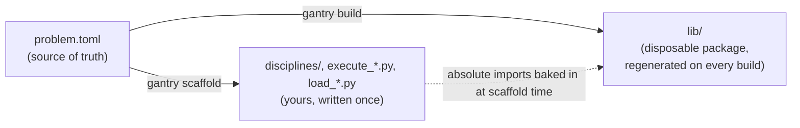

# Concepts

## Build and scaffold

`gemseo-gantry` has two commands that generate code, and they treat existing files in **opposite ways**. Most of the design follows from that split.



- **`build`** rebuilds a disposable `lib/` package on every run. It's destructive and idempotent, and it only ever wipes and rewrites `lib/`. That's safe because `lib/` never holds hand-written code. When you rename something, the generated files for the old name go away.
- **`scaffold`** writes **starter files that you own** into your project tree: discipline stubs, a scenario executor and a results loader. It won't overwrite an existing file unless you pass `--force`. Once a file is written it's yours, and the tool doesn't touch it again.

`lib/` is an importable package. Your starter files import it by an **absolute path** worked out at scaffold time rather than a relative `..lib`, so they work wherever `--disciplines-into` and `--executor-into` put them.

`build` validates the problem first and stops if it finds errors. The split between the destructive `build` and the write-once `scaffold` is enforced by tests. It doesn't depend on how your folders are laid out.

## The iteration loop

This loop is the reason the tool exists. Say you split `ballistic_coefficient` into `mass`, `Cd`, and `area`:

1. Edit `problem.toml`: remove the old variable, add the three new ones, and update the affected disciplines' inputs and outputs.
2. `gantry validate` reports every place the old variable is still referenced. Fix them.
3. `gantry build` rebuilds `lib/`. The I/O dataclasses, grammars, design space and `Var` enum all update.
4. Your already-implemented discipline files now fail type checking right at `inputs.ballistic_coefficient`. Write the new physics there.
5. `gantry scaffold` writes starter files for any new discipline and skips the files that already exist.
6. Run.

There's no three-way merge and no hidden state. The TOML is diffable, and the type checker does the reconciling.

## Project layout

With the defaults (`gantry build` and `gantry scaffold` run next to `problem.toml`), a project looks like this:

```text
problem.toml                    # source of truth, you edit this
schema/
  problem.schema.json           # GENERATED: editor validation
lib/                            # REGENERATED by `build`, never edit by hand
  <Disc>_base.py                #   grammar-wiring base classes
  <Disc>_io.py                  #   typed Inputs/Outputs dataclasses
  <Disc>_grammar.py             #   GEMSEO grammars
  <Scenario>.py                 #   scenario construction
  design_space.csv
  variables.py                  #   Var enum
disciplines/                    # WRITE-ONCE, from `scaffold`, yours
  <Disc>_scaffold.py            #   your physics (override _run)
execute_<Scenario>.py           # WRITE-ONCE: discipline wiring and run settings
load_<Scenario>.py              # WRITE-ONCE: load and inspect saved results
```

Anything under `lib/` is disposable and will be overwritten. Everything `scaffold` writes is yours.

To generate into a `src/` layout instead, point `build` at it and tell `scaffold` where the package went:

```bash
gantry build --out src
gantry scaffold --disciplines-into src/disciplines --lib-dir src/lib
```

See the [CLI reference](cli.md) for all placement options.
